<p align="center">
  
</p>

<h1 align="center">Plastinka</h1>

<p align="center">
  <b>Быстрый нативный клиент Яндекс Музыки для Windows, Linux, macOS и Android</b><br>
  Без Electron: один файл на 20 МБ, запуск за полсекунды, в 5 раз меньше памяти
</p>

<p align="center">
  <a href="https://github.com/welcomeforalone/plastinka-yamusic-rust/releases/latest"></a>
  <a href="https://github.com/welcomeforalone/plastinka-yamusic-rust/releases"></a>
  
  <a href="LICENSE"></a>
</p>

<p align="center">
  <a href="#скачать">Скачать</a> ·
  <a href="#возможности">Возможности</a> ·
  <a href="#сравнение-с-официальным-клиентом">Сравнение</a> ·
  <a href="#вопросы">Вопросы</a> ·
  <a href="#english">English</a>
</p>

<p align="center">
  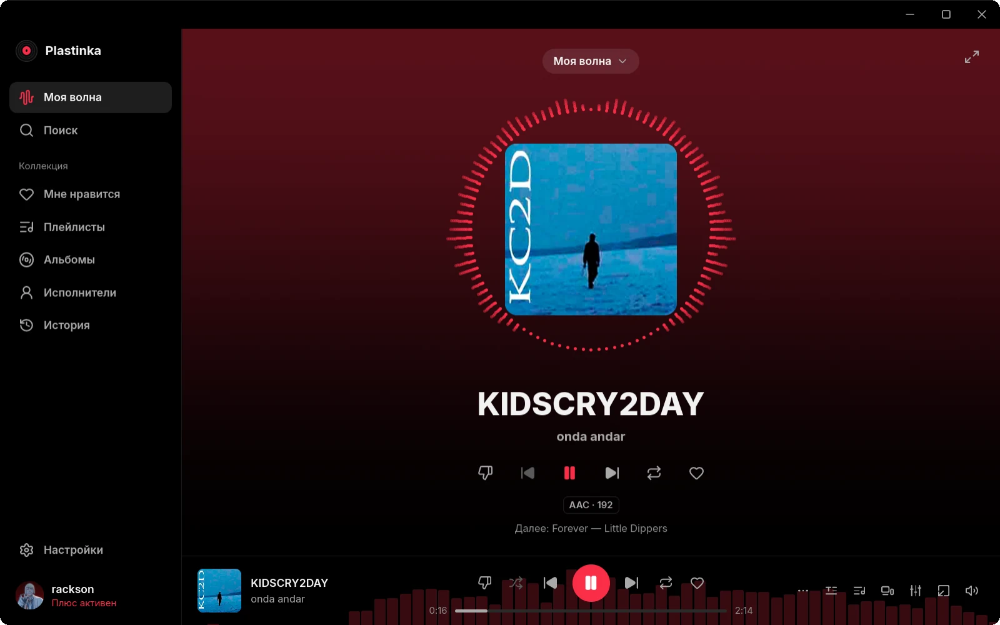
</p>

> Неофициальный клиент, не связан с ООО «Яндекс». Для музыки нужна ваша
> подписка Яндекс Плюс.

## Почему Plastinka

- **Лёгкая.** Написана на Rust, окно рисуется видеокартой. Один процесс вместо
  шести, 130 МБ памяти вместо 740 и почти ноль нагрузки на процессор в фоне.
- **Всё, что вы слушаете, на месте.** «Моя волна» с настройками, «Мне
  нравится», плейлисты, альбомы, исполнители, поиск, история, тексты песен.
- **Больше, чем в официальном клиенте.** Эквалайзер, 12 тем, мини-плеер,
  статус в Discord, «Слушать вместе» между компьютером и телефоном, копии
  недоступных треков, треки без цензуры, скачивание с тегами.
- **Открытый код.** Токен лежит только в системном хранилище паролей и
  уходит только на серверы Яндекса. Всё можно проверить в исходниках.

## Скачать

| Система | Файл | Как запустить |
|---|---|---|
| **Windows 10, 11** (x64) | [Plastinka.exe](https://github.com/welcomeforalone/plastinka-yamusic-rust/releases/latest/download/Plastinka.exe) | Скачайте и запустите. Установка не нужна |
| **Linux** (x86_64, любой дистрибутив) | [plastinka-linux-x86_64.tar.gz](https://github.com/welcomeforalone/plastinka-yamusic-rust/releases/latest/download/plastinka-linux-x86_64.tar.gz) | Распакуйте и выполните `sh install.sh` |
| **macOS** (Apple Silicon и Intel) | [plastinka-macos.zip](https://github.com/welcomeforalone/plastinka-yamusic-rust/releases/latest/download/plastinka-macos.zip) | Распакуйте и перенесите `Plastinka.app` в «Программы» |
| **Android 8.0+** | [plastinka-android.apk](https://github.com/welcomeforalone/plastinka-yamusic-rust/releases/latest/download/plastinka-android.apk) | Откройте файл на телефоне и установите |

Все версии и что в них нового — на странице [релизов](https://github.com/welcomeforalone/plastinka-yamusic-rust/releases).
Рядом с каждым файлом лежит `.sha256`, общий список — `SHA256SUMS.txt`.

<details>
<summary><b>Windows пишет «Система Windows защитила ваш компьютер»</b></summary>

Так SmartScreen встречает любую программу без платной подписи кода. Нажмите
«Подробнее» → «Выполнить в любом случае». Файл собирается в GitHub Actions из
этого репозитория, контрольная сумма — в релизе.
</details>

<details>
<summary><b>macOS пишет, что разработчик не подтверждён</b></summary>

Приложение подписано ad-hoc, без нотаризации Apple. Откройте «Системные
настройки → Конфиденциальность и безопасность» и нажмите «Всё равно открыть».
Или в терминале:

```sh
xattr -dr com.apple.quarantine /Applications/Plastinka.app
```
</details>

<details>
<summary><b>Linux: установка одной командой и нужные пакеты</b></summary>

```sh
mkdir -p ~/plastinka-install && cd ~/plastinka-install
curl -fLO https://github.com/welcomeforalone/plastinka-yamusic-rust/releases/latest/download/plastinka-linux-x86_64.tar.gz
tar -xzf plastinka-linux-x86_64.tar.gz && cd plastinka-linux-x86_64 && sh install.sh
```

Программа ставится в `~/.local/bin/Plastinka` и появляется в меню приложений.
Работает под Wayland и X11. Из пакетов нужны ALSA и Secret Service
(gnome-keyring, KWallet или KeePassXC) для хранения входа. Подробности и
решение проблем — [docs/INSTALL-LINUX.md](docs/INSTALL-LINUX.md).
</details>

**Первый запуск.** Plastinka покажет код. Откройте страницу Яндекса, введите
код и подтвердите вход. Пароль программа не видит, вход идёт через Яндекс ID.

## Возможности

### Моя волна, которая подстраивается под вас

Бесконечный поток с настройками занятия, характера, настроения и языка.
«Нравится» и «Не нравится» сразу меняют волну. Вокруг обложки — живой спектр
звука, а плагин VibeColorizer красит экран в цвет обложки.

<p align="center">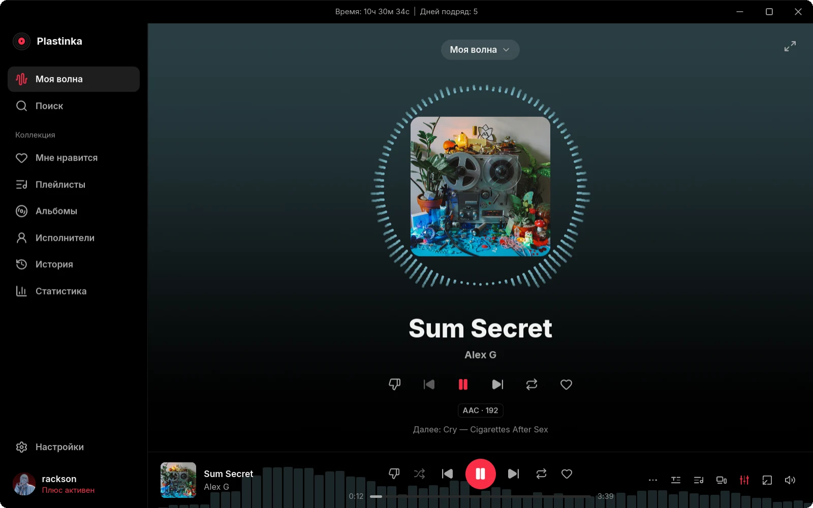</p>

### Полноэкранный плеер с синхронным текстом

Строки подсвечиваются в такт песне, щелчок по строке перематывает к ней. Если
у Яндекса текста нет, Plastinka ищет его в LRCLib.

<p align="center">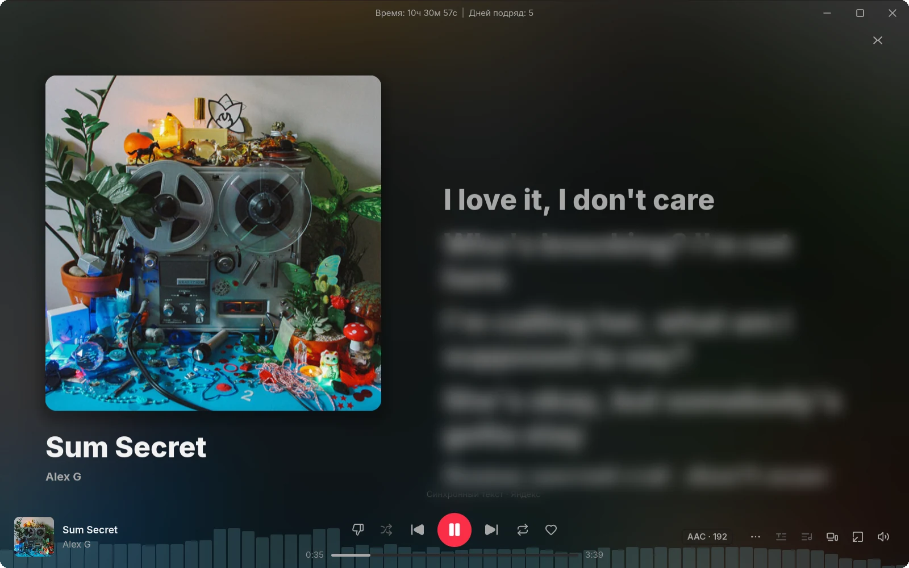</p>

### Ваша коллекция

«Мне нравится» с поиском прямо по списку, плейлисты, альбомы, исполнители с
«Топом месяца», история прослушиваний и поиск по всему каталогу.

<table>
  <tr>
    <td>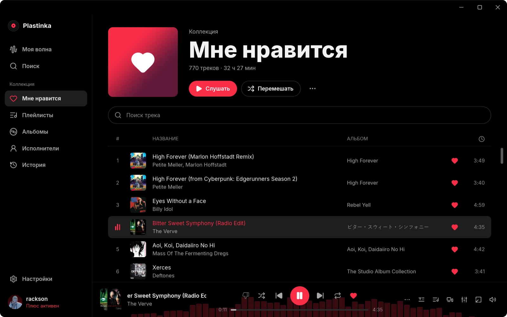</td>
    <td>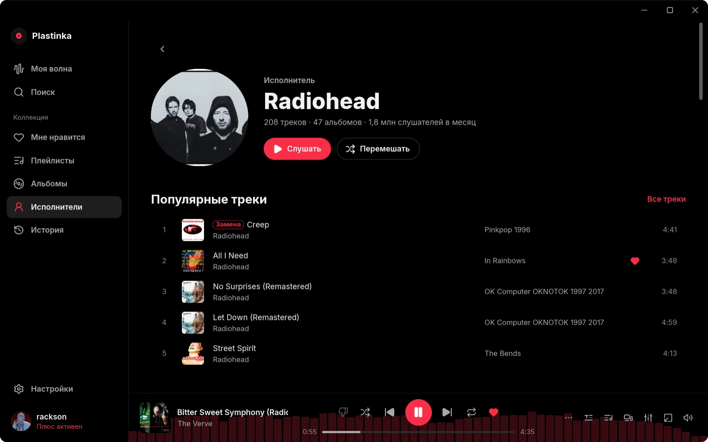</td>
  </tr>
  <tr>
    <td>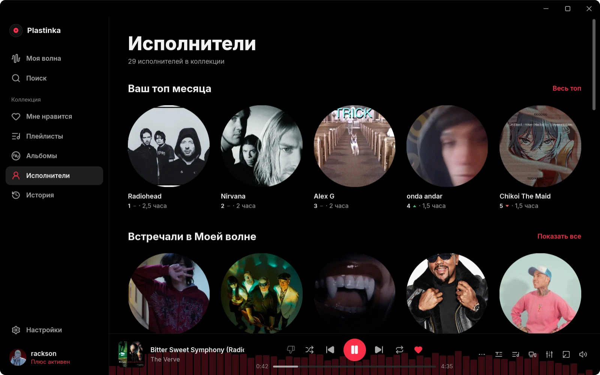</td>
    <td>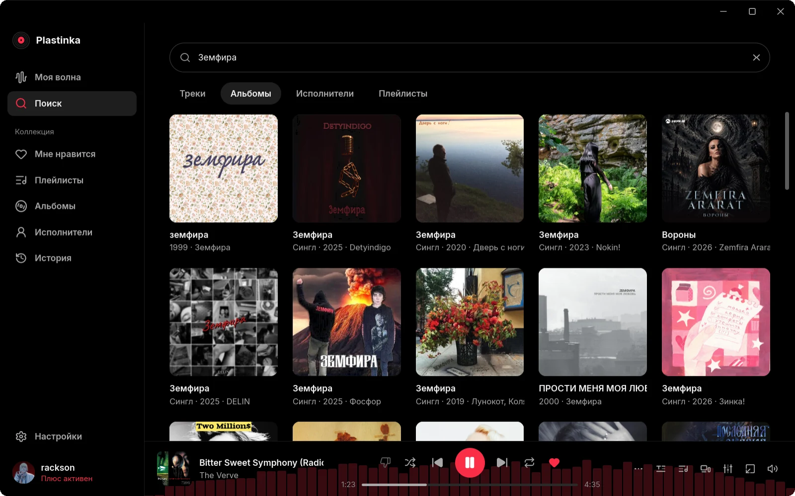</td>
  </tr>
</table>

### 12 тем, светлая и тёмная, любой акцент

Классика, Графит, Кофе, Сланец, Полночь, Океан, Лес, Матча, Янтарь, Закат,
Сакура, Бархат. Каждая — в тёмном и светлом варианте, можно следовать теме
системы. Акцент — один из восьми цветов или свой. Масштаб интерфейса от 75 до
200 %.

<p align="center">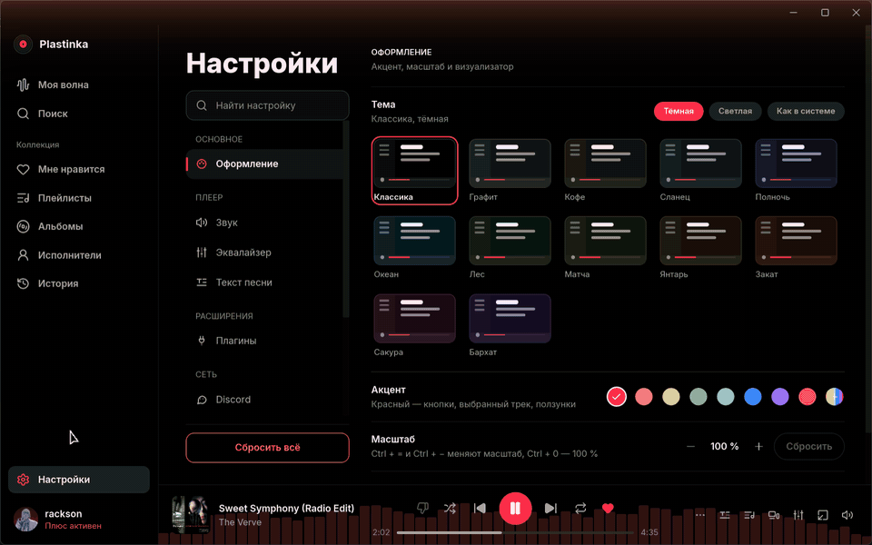</p>

### Эквалайзер на 10 полос

От 32 Гц до 16 кГц, 13 готовых пресетов и свои, автоматический предусилитель
против перегрузки. Нормализация громкости по данным сервиса. Качество — до
FLAC без потерь.

<p align="center">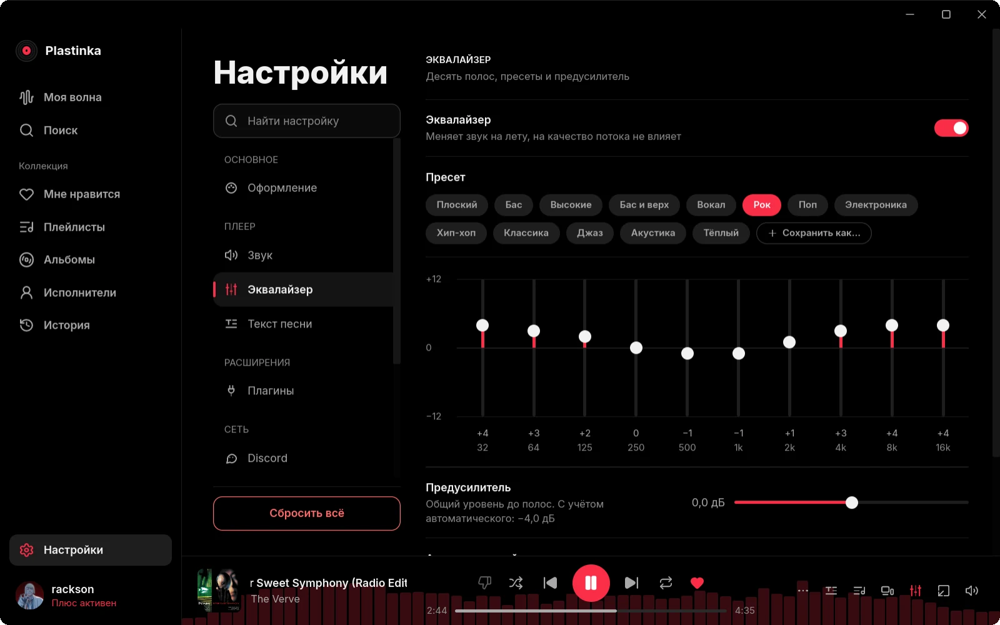</p>

### Плагины

Встроены в программу и включаются одним переключателем:

| Плагин | Что делает |
|---|---|
| **FckCensor** | Возвращает трекам названия и обложки без цензуры, находит explicit-версию трека или играет ваш файл вместо зацензуренного |
| **Slopless** | Помечает треки ИИ-исполнителей и может пропускать их |
| **CopyTrackName** | Копирует «Исполнитель — Название» в своём формате |
| **VibeColorizer** | Красит волну и спектр в цвет обложки |
| **YandexMusicTime** | Считает время прослушивания и серию дней, показывает статистику |

<table>
  <tr>
    <td>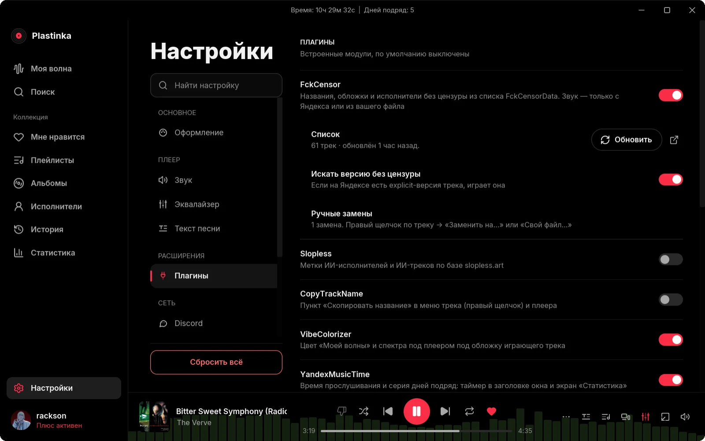</td>
    <td>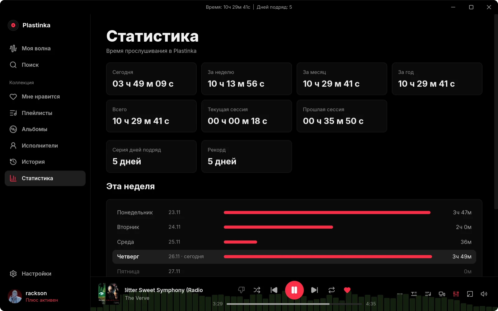</td>
  </tr>
</table>

### И ещё

- **Копии недоступных треков.** Если трек недоступен в вашем регионе или убран
  из релиза, Plastinka сама находит его в другом релизе (сборник,
  переиздание) и играет.
- **Слушать вместе.** Один трек играет на компьютере и телефоне одновременно,
  пока они в одной сети. Устройства связываются по шестизначному коду,
  трафик шифруется, токен и звук по сети не передаются.
- **Статус в Discord** — что вы слушаете, с обложкой, таймером и кнопкой
  «Слушать».
- **Мини-плеер** поверх всех окон, **медиаклавиши** и системный плеер
  (Windows, MPRIS в Linux).
- **Скачивание** треков, альбомов и плейлистов в выбранную папку, с тегами и
  обложкой, FLAC без перекодирования. Только по вашей кнопке и только с
  подпиской.
- **Трей, автозапуск и автообновление** (включается в настройках).

<table>
  <tr>
    <td width="66%">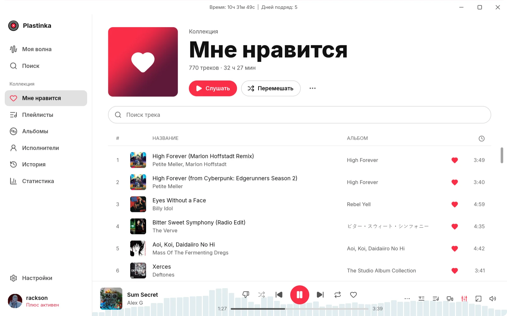</td>
    <td>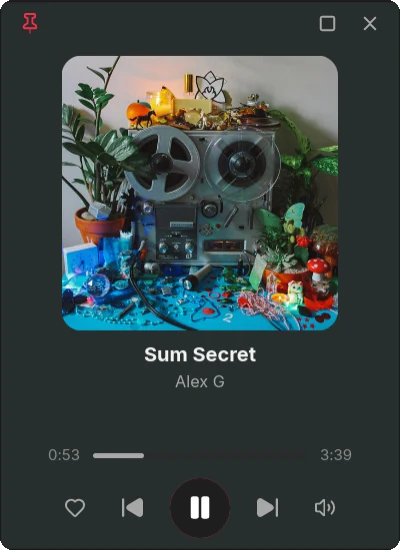</td>
  </tr>
</table>

Подробное описание каждой функции — в [docs/FEATURES.md](docs/FEATURES.md).

### Android

Отдельное приложение на Kotlin и Jetpack Compose: «Моя волна», коллекция,
поиск, тексты, эквалайзер, плагины, «Слушать вместе» с компьютером. Плеер
держит трек в памяти, поэтому короткий обрыв сети не слышен. Что есть и
чего пока нет — в [docs/ANDROID.md](docs/ANDROID.md).

## Сравнение с официальным клиентом

Windows 11, Ryzen 5 7500F, один и тот же аккаунт и сценарий на 60 секунд:
запуск, каталог, воспроизведение, полноэкранный плеер, вкладки, свёрнутое
окно.

| | Plastinka | Яндекс Музыка |
|---|---|---|
| Размер на диске | **19 МБ** | 504 МБ |
| Процессов | **1** | 6 |
| Память в Диспетчере задач | **132 МБ** | 736 МБ |
| Процессор, в среднем | **0,65 %** | 4,7 % |
| Окно появляется через | **0,55 с** | 1,0 с |

Это предварительный замер одного прогона. Числа зависят от машины и
видеокарты: окно Plastinka рисует видеокарта, и драйвер держит часть памяти у
себя.

## Вопросы

<details>
<summary><b>Это безопасно? Куда уходит мой токен?</b></summary>

Вход идёт через Яндекс ID по коду устройства: пароль программа не видит.
Токен хранится только в системном хранилище паролей (Windows Credential
Manager, Secret Service, Keychain, Android Keystore) и отправляется только на
серверы Яндекса. В файлах, логах и тексте ошибок его нет. Код открыт, сборки
делает GitHub Actions. Как сообщить об уязвимости — [SECURITY.md](SECURITY.md).
</details>

<details>
<summary><b>Нужна ли подписка?</b></summary>

Да. Plastinka проверяет Плюс после входа, без подписки музыка не играет.
Это клиент для тех, кто уже платит за Яндекс Музыку и хочет удобную программу.
</details>

<details>
<summary><b>Чем это отличается от официального приложения?</b></summary>

Музыка та же самая, с серверов Яндекса. Отличается программа: она нативная,
быстрая и лёгкая, в ней есть эквалайзер, темы, плагины, мини-плеер, Discord и
версия для Linux. Чего-то из официального клиента может не быть: напишите в
[issues](https://github.com/welcomeforalone/plastinka-yamusic-rust/issues), что вам нужно.
</details>

<details>
<summary><b>Могут ли заблокировать аккаунт?</b></summary>

Plastinka ходит к тем же адресам API, что и официальные приложения, и
представляется приложением Яндекс Музыки, как все неофициальные клиенты.
Случаев блокировки мы не знаем, но гарантий дать не можем: это может
противоречить условиям Яндекса. Подробнее — в [docs/ARCHITECTURE.md](docs/ARCHITECTURE.md).
</details>

<details>
<summary><b>Где мои настройки и как всё удалить?</b></summary>

Настройки — `%APPDATA%\Plastinka` в Windows и `~/.config/plastinka` в Linux,
кэш обложек — `%LOCALAPPDATA%\Plastinka` и `~/.cache/plastinka`. «Настройки →
Аккаунт → Выйти» удаляет токен и отзывает его. Потом можно удалить сам файл
программы и эти папки.
</details>

## Для разработчиков

- [docs/BUILDING.md](docs/BUILDING.md) — сборка из исходников и проверки
- [docs/ARCHITECTURE.md](docs/ARCHITECTURE.md) — как устроен код
- [docs/ANDROID.md](docs/ANDROID.md) — Android-клиент
- [docs/api](docs/api) — описание API Яндекс Музыки и протокола «Слушать вместе»
- [CONTRIBUTING.md](CONTRIBUTING.md) — как предложить изменения
- [docs/RELEASING.md](docs/RELEASING.md) — как выходит релиз

Стек: Rust, [iced](https://github.com/iced-rs/iced), wgpu, tokio, rodio и
symphonia. Android — Kotlin, Jetpack Compose, Media3.

## Лицензия

[GPL-3.0-or-later](LICENSE). Сторонние компоненты и источники данных —
[THIRD-PARTY.md](THIRD-PARTY.md).

Plastinka — неофициальный клиент, не связан с ООО «Яндекс». «Яндекс» и
«Яндекс Музыка» — товарные знаки их владельцев. Программа не обходит
подписку и не раздаёт музыку: каждый слушает своим аккаунтом.

---

## English

**Plastinka** is a fast, native, unofficial client for Yandex Music on
Windows, Linux, macOS and Android. It is written in Rust (iced + wgpu), ships
as a single 20 MB file and uses about 5× less memory than the official
Electron app.

- My Wave with mood and activity settings, liked tracks, playlists, albums,
  artists, search, history and synced lyrics
- 10-band equalizer, 12 themes in dark and light variants, custom accent,
  mini player, Discord Rich Presence, media keys and MPRIS
- Listen Together: play the same track on your PC and phone over the local
  network, end-to-end encrypted
- Plugins: uncensored titles (FckCensor), AI-track labels (Slopless),
  cover-colored wave (VibeColorizer), listening stats
- Your token is stored only in the OS keychain and sent only to Yandex

A Yandex Plus subscription is required. The interface is in Russian.
[Download the latest release](https://github.com/welcomeforalone/plastinka-yamusic-rust/releases/latest).
Not affiliated with Yandex LLC. Licensed under GPL-3.0-or-later.
